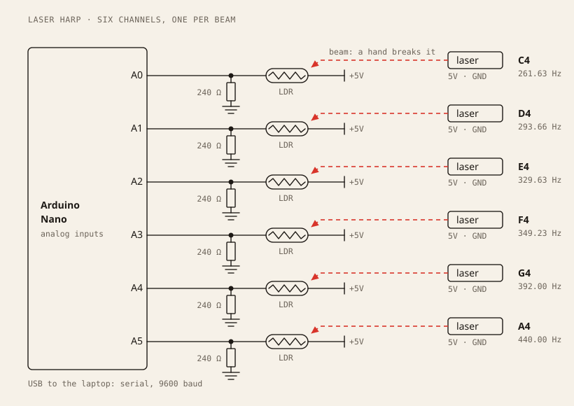

<p align="center">
  <picture>
    <source media="(max-width: 600px)" srcset="docs/readme/sheet-mobile.svg">
    
  </picture>
</p>

<p align="center"><b><a href="https://ashiswadhwani.in/blog/laser-harp">Read the write-up</a></b> · break a beam, hear a note</p>

<details>
<summary><b>The full circuit, all six channels</b></summary>
<br>
<p align="center"></p>
</details>

---

## How it works

```
laser ──light──▶ LDR + 240 Ω divider ──volts──▶ Arduino Nano ──USB serial──▶ Laser_Harp.py ──▶ speakers
                 (one per beam, A0–A5)          "which beam is dark?"  "A0\n"   note map, NumPy synth,
                                                                                 simpleaudio
```

- **The board only answers one question: which beam is dark?** It reads A0 to A5 in order, and the first pin at or below **190** (out of 1023, about 0.93 V) is the note. It prints that pin's name and goes back to watching.
- **Everything that makes sound lives on the laptop.** A Nano has no real audio output; Python builds a proper waveform and plays it through real speakers. Changing a note or the tone is a script edit, not a re-flash.
- **The link is plain text.** One line per beam (`A0` … `A5`) at 9600 baud, so the Arduino Serial Monitor shows exactly what the board is sending.
- **One pass, one note.** After sending a note the board waits 500 ms, so a hand moving through a beam plays it once instead of dozens of times.
- **Notes ring out.** Each note is a one-second sine with an exponential fade (0.3 s time constant), built once at start-up and played on its own thread, so a new note doesn't cut off the last.

| Beam | Pin | Note | Frequency |
|---|---|---|---|
| 1 | A0 | C4 | 261.63 Hz |
| 2 | A1 | D4 | 293.66 Hz |
| 3 | A2 | E4 | 329.63 Hz |
| 4 | A3 | F4 | 349.23 Hz |
| 5 | A4 | G4 | 392.00 Hz |
| 6 | A5 | A4 | 440.00 Hz |

## Build it

**Parts:** an Arduino Nano and USB cable, 6 laser modules (5 V), 6 photoresistors (LDRs), 6 × 240 Ω resistors, and a laptop with speakers.

Wire six identical channels:

| From | To | Why |
|---|---|---|
| LDR | **+5V** → analog pin (A0–A5) | Lit: low resistance, pin near 5 V |
| 240 Ω resistor | analog pin → **GND** | Pulls the pin down when the beam is blocked |
| Laser module | **+5V** and **GND** | Always on, aimed at its LDR |

## Run it

Needs the Arduino IDE and Python 3.

```bash
# 1. upload Laser_Harp.ino to the Nano from the Arduino IDE
# 2. install the player's dependencies
pip install -r requirements.txt
# 3. start it on the Nano's port (Arduino IDE → Tools → Port)
python Laser_Harp.py COM3            # Windows
python Laser_Harp.py /dev/ttyUSB0    # Linux
```

Then break a beam. Close the Serial Monitor first: only one program can hold the port.

| Option | Default | What it does |
|---|---|---|
| `port` | `COM3` | Serial port of the Nano |
| `--baud` | `9600` | Must match `Serial.begin()` in the firmware |

## Project layout

```
Laser_Harp.ino        firmware: read six sensors, report the blocked beam
Laser_Harp.py         laptop: serial reader, note map, synth, playback
requirements.txt      pyserial, numpy, simpleaudio
docs/
  schematic.svg       the circuit, all six channels
  readme/             README header images and the script that draws them
```

## Limits worth knowing

- **One note at a time.** The pins are checked in order, so if two beams are blocked, the lower pin wins. No chords.
- **Holding a beam repeats the note** every 500 ms, which also caps playing speed at two notes a second.
- **The threshold is fixed.** 190 suits the room it was tuned in. Under much brighter light a blocked LDR may not read low enough; change `BLOCKED_AT_OR_BELOW` in the firmware if so.
- **The laptop is part of the instrument.** No laptop, no sound: the board only reports beams.

## Regenerating the README images

```bash
python3 docs/readme/make_svg.py     # rebuilds sheet.svg + sheet-mobile.svg (stdlib only)
```

`docs/schematic.svg` comes from the same code that draws the circuit in the [write-up](https://ashiswadhwani.in/blog/laser-harp), so both always show the same wiring.
