<picture>
  <source media="(max-width: 600px)" srcset="docs/readme/harp-mobile.svg">
  
</picture>

# Laser Harp

Six laser beams for strings. Put your hand in one and the harp plays its note.

An Arduino Nano watches the beams and says which one went dark. A Python script on the laptop hears that, builds the note, and plays it. I built it in December 2023; the full story is in the write-up: **[ashiswadhwani.in/blog/laser-harp](https://ashiswadhwani.in/blog/laser-harp)**.

## The six strings

| | C4 | D4 | E4 | F4 | G4 | A4 |
|---|:-:|:-:|:-:|:-:|:-:|:-:|
| **Pin** | A0 | A1 | A2 | A3 | A4 | A5 |
| **Hz** | 261.63 | 293.66 | 329.63 | 349.23 | 392.00 | 440.00 |

Six white keys up from middle C.

## From light to sound

1. **Light.** Each laser shines on its own photoresistor (LDR).
2. **Volts.** The LDR and a 240 Ω resistor make a voltage divider on one analog pin. Lit, the pin sits near 5 V. With a hand in the beam the LDR goes dark and the pin drops.
3. **"A2".** The Nano reads A0 to A5 in order. The first pin at or below 190 (of 1023, about 0.93 V) is the note, so it prints that pin's name over USB serial at 9600 baud, then waits half a second so one pass of a hand is one note.
4. **E4.** `Laser_Harp.py` looks the name up, and plays a one-second sine at that pitch that fades with a 0.3 s time constant, which sounds closer to a plucked string than a test tone. Each note gets its own thread, so they overlap and ring out.

The board does no audio at all. That keeps the sound in Python, where changing a note is an edit, not a re-flash.

## Wiring

<details>
<summary>The full circuit, all six channels</summary>
<br>

</details>

Six identical channels, one per beam:

- **LDR** from +5V to the analog pin
- **240 Ω** from the same pin to GND
- **Laser module** on +5V and GND, aimed at that LDR (always on)

You'll need an Arduino Nano, 6 laser modules (5 V), 6 LDRs, 6 × 240 Ω resistors, a USB cable, and a laptop with speakers.

## Playing it

1. Open `Laser_Harp.ino` in the Arduino IDE and upload it to the Nano.
2. Install the player's dependencies:
   ```bash
   pip install -r requirements.txt
   ```
3. Start it on the Nano's serial port (Arduino IDE → Tools → Port shows it):
   ```bash
   python Laser_Harp.py COM3            # Windows (the default)
   python Laser_Harp.py /dev/ttyUSB0    # Linux
   ```
4. Break a beam.

Close the Arduino Serial Monitor first; only one program can hold the port. `--baud` is there if you ever change `Serial.begin()`.

## Quirks

- **One note at a time.** Two hands in two beams: the lower pin wins.
- **A held beam repeats** its note every half second.
- **Bright rooms.** The 190 threshold was tuned for one room. If blocked beams stop registering under strong light, raise `BLOCKED_AT_OR_BELOW` in the firmware.
- **No laptop, no music.** The board only reports beams; the sound comes from Python.

## What's in here

| | |
|---|---|
| `Laser_Harp.ino` | Firmware: read six sensors, report the dark beam |
| `Laser_Harp.py` | Player: serial reader, note table, synth, playback |
| `requirements.txt` | pyserial, numpy, simpleaudio |
| `docs/schematic.svg` | The circuit |
| `docs/readme/` | The banner above, and `draw_banner.py`, which draws it (`python3 docs/readme/draw_banner.py`) |
